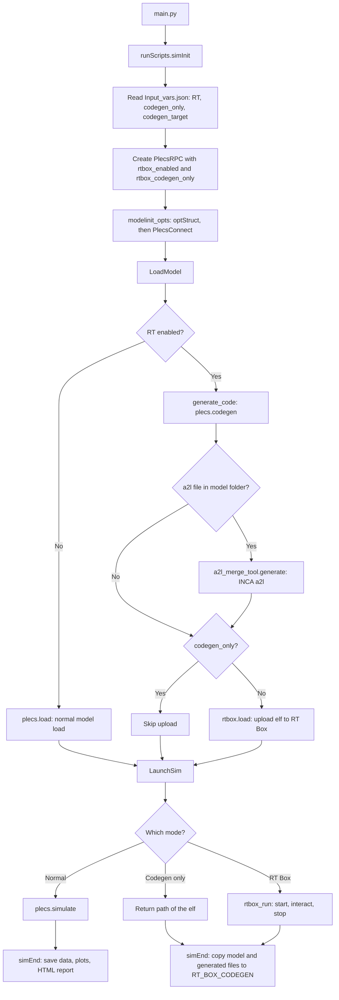
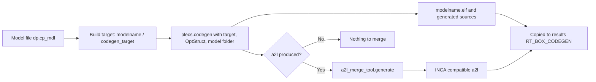
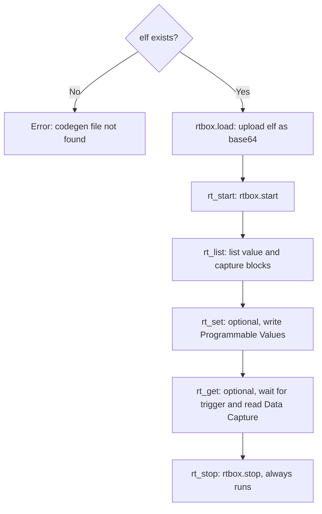

# How it works

This page explains what PyPLECS does internally when `RT` is enabled. Everything lives in the existing classes: the RT Box support is built into **`PlecsRPC`** (`Script/Lib/pyplecs_rpc.py`), so there is no separate RT Box object. `runScripts` (`Script/Lib/RunScripts.py`) only passes the two flags in.

---

## Overall flow

> **Diagram:** copy the code block below into draw.io via **Arrange → Insert → Advanced → Mermaid** (in Confluence: draw.io macro, then the same menu).

### Step by step

| # | Where | What happens |
|---|---|---|
| 1 | `runScripts.__init__` | Reads `RT` from `Input_vars.json` into `rt_enabled_flag`. |
| 2 | `runScripts.simInit` | Runs the `ModelVars` items, then creates `PlecsRPC(..., rtbox_enabled=RT, rtbox_codegen_only=codegen_only)`. |
| 3 | `PlecsRPC.modelinit_opts` | Builds `OptStruct` (ModelVars / SolverOpts / AnalysisOpts), waits briefly, then calls `PlecsConnect()`. That creates the single `self.server` connection (XML-RPC or JSON-RPC to `url:port`). |
| 4 | `PlecsRPC.LoadModel` | **Normal:** `plecs.load(model)`. **RT:** `generate_code()`, then the `.elf` is uploaded with `rtbox.load` unless `codegen_only`. |
| 5 | `PlecsRPC.LaunchSim` | **Normal:** `plecs.simulate`. **Codegen only:** returns the `.elf` path. **RT Box:** `rtbox_run()`. |
| 6 | `runScripts.simEnd` / `Pylog.copyfiles` | For RT runs, simulation-only steps (save data, scopes, HTML plots) are skipped, and the model and generated files are copied into `<results>/RT_BOX_CODEGEN`. |

The rest of the program (results folder, log, run header) is the same as for a normal simulation.

---

## Code generation

`PlecsRPC.generate_code()` is the RPC equivalent of pressing **Build** in PLECS Coder Options.

**Details**

- **Target path:** PLECS can only generate code for a *subsystem* with *Enable code generation* ticked, and every Target I/O block must sit at that subsystem's top level. The bare model name is not enough. PyPLECS builds `"<modelname>/<codegen_target>"` for you, for example `Boost_integrated/Plant + Controller`.
- **Parameters:** codegen uses the same `OptStruct` (ModelVars, SolverOpts, AnalysisOpts) a normal simulation would use. Whatever `Input_vars.json` sets ends up in the generated code.
- **Output folder:** PLECS writes into the **model's own folder** (`os.path.dirname(dp.cp_mdl)`).
- **Output name:** PyPLECS expects `<modelname>.elf`. That only holds if **Coder Options → Base name** equals the model file name. Otherwise the upload step cannot find the file.
- **A2L → INCA:** if any `*.a2l` file is found in the output folder after codegen, PyPLECS runs `a2l_merge_tool.generate()` on it silently (the same tool as the A2L-INCA GUI, without the GUI). A failure here is printed as *non-fatal* and does not stop the run.

---

## RT Box

The upload happens in `LoadModel()`, and the run happens in `LaunchSim()` → `rtbox_run()`. The RT Box therefore follows the same "load, then launch" order as a normal PLECS model.

**Details**

- **Upload:** the `.elf` is read, base64-encoded and sent with `rtbox.load`. A missing file raises *"Codegen executable not found or not yet generated"*.
- **Run:** `rtbox_run()` starts the program, lists the Programmable Value and Data Capture blocks, optionally writes values and reads captures, and **always stops the RT Box** in a `finally` block, even if an earlier step failed.
- **Default behaviour:** `LaunchSim()` calls `rtbox_run()` with no arguments, so a standard run starts and stops the program without writing or capturing anything. To write values or capture data, call `rtbox_run(set_values=..., capture_blocks=...)`. See the *Codegen + RT Box* example page.
- **Disabled safety:** every RT Box method (`rt_start`, `rt_stop`, `rt_set`, `rt_get`, `rt_list`, `rt_query`, `rt_log`, `rt_reboot`) does nothing when `RT` is `false`, so normal runs can never touch hardware by accident.

### RT Box helper methods

| Method | RPC call | Purpose |
|---|---|---|
| `rt_start()` | `rtbox.start` | Start real-time execution |
| `rt_stop()` | `rtbox.stop` | Stop real-time execution |
| `rt_reboot()` | `rtbox.reboot` | Reboot the RT Box |
| `rt_list()` | `rtbox.getProgrammableValueBlocks`, `rtbox.getDataCaptureBlocks` | List input / capture blocks |
| `rt_query()` | `rtbox.querySimulation` | Status of the running model |
| `rt_set(block, values)` | `rtbox.setProgrammableValue` | Write a Programmable Value block |
| `rt_get(blocks, ...)` | `rtbox.getCaptureTriggerCount`, `rtbox.getCaptureData` | Wait for a capture trigger and read the data |
| `rt_log()` | `rtbox.getApplicationLog` | Read the application log |

---

## Files in the results folder

For every run with `RT: true`, `Pylog.copy_model_folder_files()` copies into `<results>/RT_BOX_CODEGEN/`:

- **This model's** `.plecs` file. Other models' `.plecs` files in the same folder are skipped.
- **Every other file** in the model folder: `.elf`, `.a2l`, the INCA `.a2l`, generated `.c`/`.h`, and so on.
- **No subfolders**: the copy is flat, one level only.

---

## Known limitations / to confirm

> **Warning:** one connection for PLECS and the RT Box. `PlecsConnect()` opens a single connection to `url:port` (no `/RPC2`) and uses it for both `plecs.*` and `rtbox.*` calls. The RT Box reference documents its own RPC server at `http://<rtbox-ip>:<port>/RPC2`. This still needs confirming on real hardware.

- Use `parallel: false` and a single iteration for RT runs.
- Codegen output is written to the model folder first and only then copied to the results folder, so files from an earlier codegen of the same model are overwritten in the model folder.
