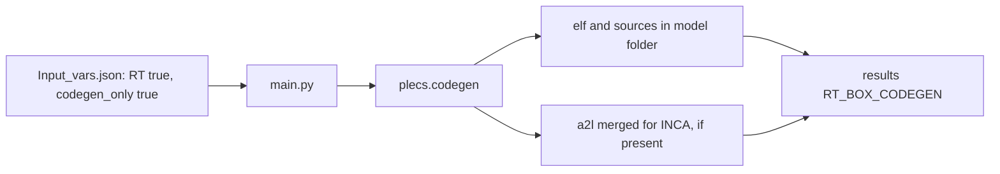

# Example – Codegen only

Generate the real-time code (`.elf`, generated sources and the INCA `.a2l` if PLECS writes an `.a2l`) **without an RT Box connected**.

Example model used on this page: `Boost_integrated.plecs`, with the code-generation subsystem `Plant + Controller`.



---

## 1. Prepare the model (once)

1. Open `Boost_integrated.plecs` in PLECS.
2. Right-click the subsystem **`Plant + Controller`**, open **Subsystem → Execution settings…**, and tick **Enable code generation**.
3. Make sure every **Target I/O block** (Analog In/Out, Digital In/Out, PWM Out, …) sits at the **top level** of that subsystem.
4. Open **Coding → Coder options…** and set:
   - **Target:** your RT Box type (for example *PLECS RT Box 1*).
   - **Base name:** `Boost_integrated`, exactly the model file name without `.plecs`.
5. Save the model.

> **Tip:** if the Base name differs from the model name, PLECS writes the `.elf` under a different name and PyPLECS reports that it cannot find `Boost_integrated.elf`.

---

## 2. Configure `Input_vars.json`

In `Script/assets/Configuration/Input_vars.json`:

```json
"modelname"      : "Boost_integrated.plecs",
"parallel"       : false,
"maxThreads"     : 1,

"RT"             : true,
"codegen_only"   : true,
"codegen_target" : "Plant + Controller"
```

- `codegen_target` is only the subsystem name. Do **not** write `Boost_integrated/Plant + Controller`.
- Use a single parameter set (no sweep). Any `ModelVars` values set in the file are used for the generated code.

---

## 3. Run

1. Start PLECS and make sure the RPC interface is enabled (default port `1080`).
2. Run PyPLECS as usual:

```bat
python main.py
```

Expected console output (shortened):

```text
RT Box rtbox_codegen_only=True — code generated, skipping upload.
```

If an `.a2l` was produced and the merge fails for some reason, you will see a *non-fatal* message and the run still finishes:

```text
A2L merge for INCA failed for ...\Boost_integrated.a2l (non-fatal): <reason>
```

---

## 4. Result

Generated files first land in the **model folder** and are then copied to the run's results folder:

```text
<results>\<run folder>\
└── RT_BOX_CODEGEN\
    ├── Boost_integrated.plecs        ← the model that was used
    ├── Boost_integrated.elf          ← executable for the RT Box
    ├── Boost_integrated.a2l          ← raw A2L from PLECS Coder (if generated)
    ├── <INCA-adapted .a2l>           ← written by the A2L/INCA merge
    └── *.c / *.h ...                 ← generated sources
```

No data files, scope plots or HTML report are created in this mode, because no offline simulation runs.

---

## Troubleshooting

| Message / symptom | Cause | Fix |
|---|---|---|
| *Cannot generate target code for Target I/O Block '…' because it is not on the top level.* | `codegen_target` is empty or wrong, or a Target I/O block is nested deeper | Set `codegen_target` to the subsystem with *Enable code generation* ticked, and move the I/O blocks to its top level |
| `.elf` has a different name than the model | Coder Options Base name not set | Set Base name to the model file name |
| Connection refused | PLECS not running or RPC disabled | Start PLECS and enable RPC on the port in `Dependencies.py` |
| No INCA `.a2l` | PLECS did not produce an `.a2l` for this target | Check Coder Options for A2L generation |
