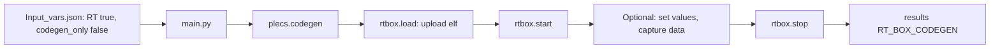

# Example – Codegen + RT Box

Generate the code, **upload it to the RT Box and run it**, all from one PyPLECS run.

Example model used on this page: `Boost_integrated.plecs`, with the code-generation subsystem `Plant + Controller`.



> **Warning (to confirm on hardware):** PyPLECS currently sends both the PLECS calls and the RT Box calls over **one connection** (`url:port` in `Dependencies.py`, no `/RPC2`). The RT Box reference documents its own RPC server at `http://<rtbox-ip>:<port>/RPC2`. Check this on the bench before relying on it.

---

## 1. Prepare the model and the hardware

1. Prepare the model exactly as in **[Example – Codegen only](./Example-Codegen-only)**, step 1: *Enable code generation* on `Plant + Controller`, Target I/O blocks at its top level, Coder Options **Target** = your RT Box and **Base name** = `Boost_integrated`.
2. Connect the RT Box to the network and check you can reach it (for example with the RT Box web interface or `ping`).
3. Set `url` and `port` in `Script/assets/Dependencies.py` to the address PyPLECS should talk to.

---

## 2. Configure `Input_vars.json`

```json
"modelname"      : "Boost_integrated.plecs",
"parallel"       : false,
"maxThreads"     : 1,

"RT"             : true,
"codegen_only"   : false,
"codegen_target" : "Plant + Controller"
```

The only difference from codegen-only is `"codegen_only": false`.

---

## 3. Run

```bat
python main.py
```

What happens, in order:

1. **Codegen:** `plecs.codegen` builds `Boost_integrated.elf` in the model folder, and the A2L/INCA merge runs if an `.a2l` appears.
2. **Upload:** the console prints `Uploading executable: ...\Boost_integrated.elf` and the file is sent with `rtbox.load`.
3. **Run:** `rtbox_run()` starts the program, lists its Programmable Value / Data Capture blocks, then stops it.
4. **Copy:** the model and all generated files are copied to `<results>\<run folder>\RT_BOX_CODEGEN\`.

> **Note:** the RT Box is **always stopped** at the end, even if a step in between raised an error.

---

## 4. Optional – write values and capture data

By default, `LaunchSim()` calls `rtbox_run()` without arguments: start, list blocks, stop. To write inputs and read captures, call it with arguments. Block names are the names of the **Programmable Value** and **Data Capture** blocks in the model:

```python
data = self.obj.rtbox_run(
    set_values     = {"Vref": [12.0], "Iload": [5.0]},   # Programmable Value blocks -> values
    capture_blocks = ["Capture_Vout", "Capture_IL"],      # Data Capture blocks to read
    poll_interval  = 0.5,                                  # seconds between trigger checks
    timeout        = 10,                                   # raise TimeoutError after 10 s without a trigger (RT Box is still stopped)
)
# data == {"Capture_Vout": <capture data>, "Capture_IL": <capture data>}
```

`rt_get` waits until the first capture block has triggered at least once, then reads every listed block.

Other helpers available on the same object: `rt_query()` (status), `rt_log()` (application log) and `rt_reboot()`.

---

## 5. Result

```text
<results>\<run folder>\
└── RT_BOX_CODEGEN\
    ├── Boost_integrated.plecs
    ├── Boost_integrated.elf
    ├── Boost_integrated.a2l          (if generated)
    ├── <INCA-adapted .a2l>
    └── *.c / *.h ...
```

---

## Troubleshooting

| Message / symptom | Cause | Fix |
|---|---|---|
| *Codegen executable not found or not yet generated: …* | `.elf` missing or named differently | Check codegen succeeded and that Coder Options Base name = model name |
| Upload rejected by RT Box | Target in Coder Options does not match the RT Box type, or the RT Box is busy | Set the right Target, stop any running model, or call `rt_reboot()` |
| `rt_get` never returns, or `TimeoutError: No trigger on …` | Capture never triggers | Check the trigger settings of the Data Capture block; pass a `timeout` so it cannot hang |
| *Failed to stop RT Box cleanly.* | Connection lost during the run | Check the network and stop the model from the RT Box web interface |
