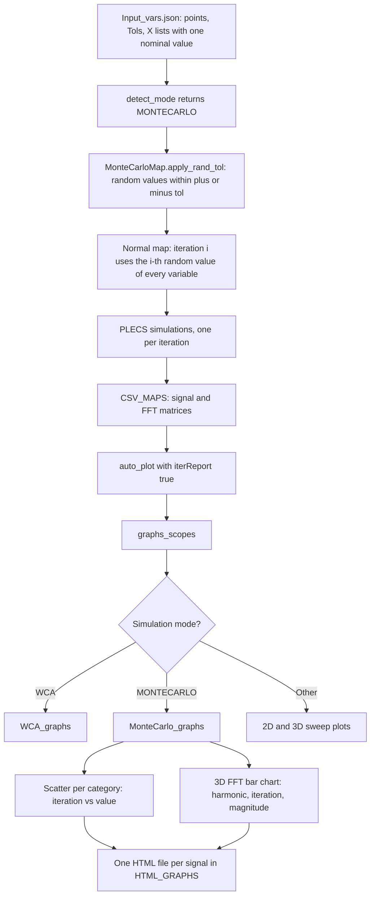
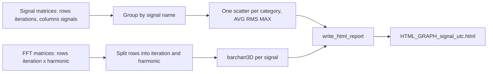

# Monte Carlo analysis & plotting

PyPLECS can run a **Monte Carlo analysis**. Each selected sweep variable gets a set of random values within ± its tolerance around its nominal value. The model is simulated once per random point, and PyPLECS produces **one interactive HTML page per signal** that shows how that signal spreads across the iterations:

- **Distribution plots:** one scatter plot per result category (AVG, RMS, MAX, …), with *iteration* on the x-axis and *signal value* on the y-axis.
- **3D FFT plot:** one 3D bar chart per signal, with *harmonic order* × *iteration* × *magnitude*.

The plots are built in `HTML_REPORT.MonteCarlo_graphs()` (`Script/Lib/py_plot.py`), next to the existing `WCA_graphs()`.

---

## How it works

> **Diagram:** copy the code block into draw.io via **Arrange → Insert → Advanced → Mermaid**.



### 1. Mode detection

`simutil.detect_mode()` picks **MONTECARLO** when all of these hold:

| Key | Value |
|---|---|
| `parallel` | `true` (otherwise the mode becomes *SINGLE*) |
| `perturbation` | `0` (otherwise *SENSITIVITY*) |
| `points` | greater than `0`: the number of Monte Carlo iterations |

### 2. Random point generation

`MonteCarloMap.apply_rand_tol()` (`Script/Lib/MapCalculation/MapCalculation.py`):

- **Active variables** are the X lists (`X1`–`X10`) with **exactly one value**, for example `"X2": "[400]"`. That value is the nominal. Lists equal to `[0]` are ignored.
- For each active variable, it draws `points` values uniformly as `nominal × (1 + u)`, with `u` between `-tol` and `+tol`.
- `Tols` holds one **relative** tolerance per active variable, in the same order (`0.05` = ±5 %).
- The lists are then swept as a *normal* map, so iteration *i* uses the *i*-th random value of each variable. **Number of iterations = `points`**.
- **Seed:** the random generator uses `dp.seed`. A new seed is drawn for each run and written to the run log (`Seed = …`). To repeat a run exactly, set `seed` in `Script/assets/Dependencies.py` to the logged value.

### 3. Plot generation



- **Signal data:** each CSV map is a matrix of *iterations × signals*. Columns are grouped by signal name. In standalone mode the category suffix is stripped from the header, so `I_L1_AVG` and `I_L1_RMS` both belong to **`I_L1`**. Every category becomes a scatter plot (x = iteration 1…N, y = value).
- **FFT data:** the FFT map stores the rows in order *iteration 0 / harmonic 0…H, iteration 1 / harmonic 0…H, …*. They are unpacked into (harmonic, iteration, magnitude) and drawn with the existing `barchart3D()`.
- **Output:** for each signal, all its figures (categories first, then the FFT) go into one HTML file written by `write_html_report()`.

---

## Example

Monte Carlo on **input voltage** (nominal 400 V, ±10 %) and **output power** (nominal 2000 W, ±5 %), with 50 iterations.

### `Input_vars.json`

```json
"X1"            : "[0]",
"X2"            : "[400]",
"X3"            : "[0]",
"X4"            : "[2000]",

"parallel"      : true,
"permute"       : false,
"perturbation"  : 0,
"points"        : 50,
"Tols"          : [0.10, 0.05],

"saveData"      : true,
"iterReport"    : true,
"FFT"           : true,
"hrmcs"         : 10,
"FundFreq"      : 100e3
```

> **Note:** for Monte Carlo, `Tols` must be a real JSON list (`[0.10, 0.05]`) and not the string form `"[0.10, 0.05]"`. It is passed to `apply_rand_tol()` without `eval()`.

- `X2` and `X4` are the active variables, so `Tols[0]` = 0.10 applies to X2 and `Tols[1]` = 0.05 applies to X4.
- `saveData` and `iterReport` must both be `true`, or no plots are generated.
- With `FFT: false`, only the distribution plots are created.

### Run

```bat
python main.py
```

### Result

```text
<results>\<run folder>\
├── CSV_MAPS\                         ← signal and FFT matrices (input to the plots)
├── HTML_GRAPHS\
│   ├── HTML_GRAPH_I_L1_<utc>.html     ← AVG / RMS / MAX scatter + 3D FFT for I_L1
│   ├── HTML_GRAPH_V_out_<utc>.html
│   └── ...                            ← one file per signal
└── <run log>                          ← includes "Seed = ..." for reproducing the run
```

How to read the plots:

- **Scatter:** the vertical spread shows how sensitive that signal is to the combined tolerances. Points far from the cloud point to an outlier iteration. Hover to see the iteration number, then look it up in the run log or map.
- **3D FFT:** each row along the iteration axis is one spectrum. Rows that differ from the others show which iterations change the harmonic content.

---

## Tips & limitations

- **Iterations vs threads:** the run is split into parallel batches. PyPLECS uses the largest thread count (≤ `maxThreads`) that divides `points` evenly, so pick `points` as a multiple of `maxThreads`.
- **Large runs:** the 3D FFT chart has *iterations × (hrmcs + 1)* bars per signal. With many iterations (hundreds) and many harmonics, the HTML gets heavy and slow in the browser. Reduce `hrmcs` or split the run.
- **Uniform distribution only:** values are drawn uniformly within ±tol, not normally distributed.
- **Only single-value X lists vary:** an X list with several values (for example `"[300,400]"`) is not an active Monte Carlo variable.
